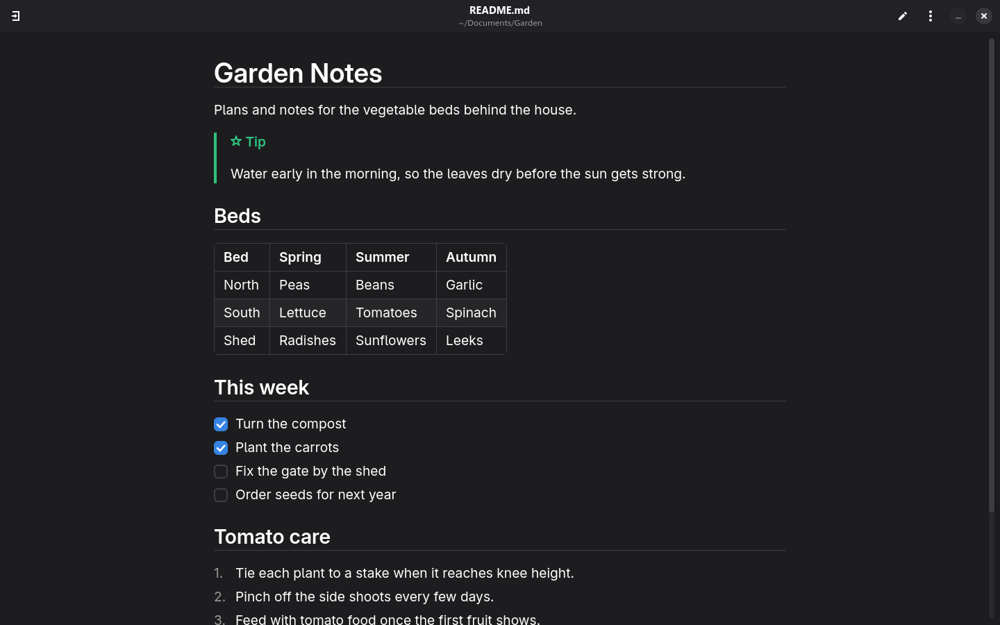

  

<h1 align="center">Crimson Text</h1>

A Linux text viewer and editor for <a href="https://daringfireball.net/projects/markdown/">Markdown</a> and other formats. 
Click the pencil to edit, and click again to preview. 
For READMEs, logs, TODO lists and CSV tables.

  
  
  

  <a href="https://github.com/Crimson-Org/crimson-text/releases/latest"><b>Download Here!</b></a>

  

## Why

Most viewers load slowly or clutter the screen with controls.\
Crimson Text shows only the document, with an optional contents sidebar.

## About

### Markdown

[GitHub](https://github.github.com/gfm/), [Obsidian](https://obsidian.md/) and [Pandoc](https://pandoc.org/) flavoured Markdown, with tables, task lists, alerts and HTML logos and badges.

### Large files

Large files and pictures never freeze the window, since they load in pieces.\
Files reload by themselves when changed on disk, unless you have unsaved edits.

### More than Markdown

Code and logs open with colours, TODO files become tickable lists and CSV files become tables.

## Building

You need a [C compiler](https://gcc.gnu.org/), [make](https://www.gnu.org/software/make/), [pkg-config](https://www.freedesktop.org/wiki/Software/pkg-config/) and the development files for [GTK4](https://gtk.org), [libadwaita](https://gnome.pages.gitlab.gnome.org/libadwaita/), [GtkSourceView](https://gitlab.gnome.org/GNOME/gtksourceview) and [libcurl](https://curl.se/libcurl/).\
On [openSUSE](https://www.opensuse.org/) these come from `sudo zypper install gcc make pkg-config gtk4-devel libadwaita-devel gtksourceview5-devel libcurl-devel`.

Steps:
 1. Clone using `git clone --recurse-submodules https://github.com/Crimson-Org/crimson-text`
 2. Run `sh .crimson-build/install.sh`

`sh .crimson-build/install-default.sh` also makes Crimson Text the app for text, Markdown, JSON, TOML and XML files.\
`sh .crimson-build/uninstall.sh` uninstalls Crimson Text.
